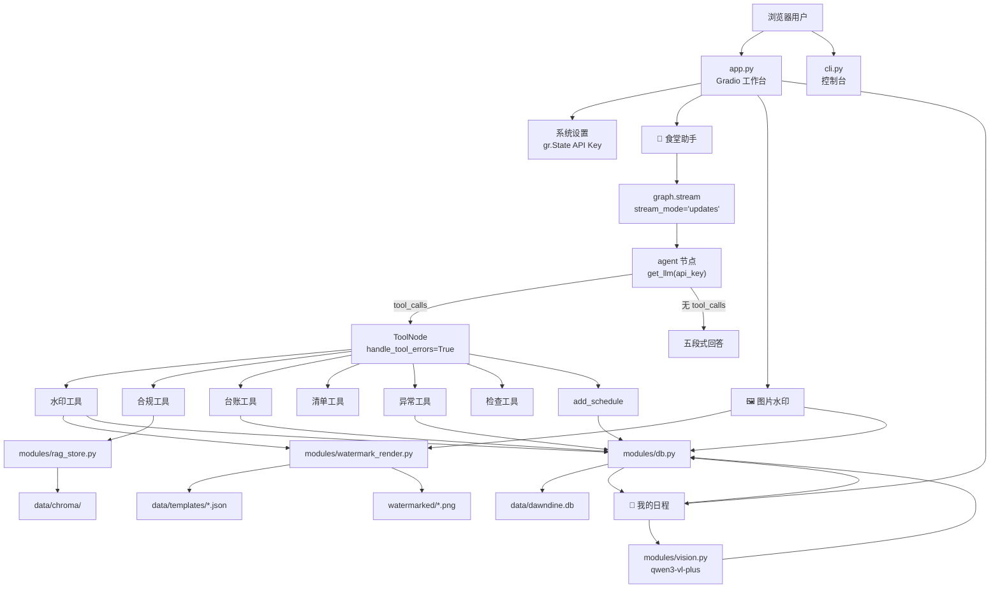
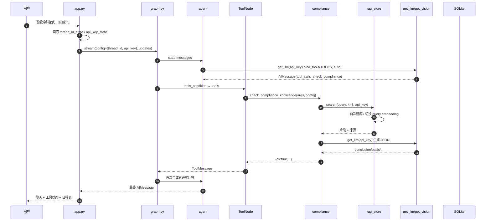

# 校园食堂后勤助手 · 架构说明

> 重构版：左侧导航 + 三页工作台 + 动态 Key + 独立 Thread + SQLite 日程。
> 适用于项目答辩、代码评审和部署说明。

---

## 1. 总体架构



### 启动链路

```text
uv run main.py
  → configure_logging()
  → ensure_runtime_dirs()
  → init_db()
  → 默认: app.launch()
      → build_demo()
      → /load → init_session()
          → uuid thread_id
          → Key 状态
          → 日程 Dataframe
          → 模板列表
  → 127.0.0.1:7860
```

---

## 2. 三页工作台

### 2.1 页面结构

```text
gr.Blocks
├── gr.Sidebar（桌面）
│   ├── 品牌：校园食堂后勤助手
│   ├── gr.Radio：食堂助手 / 图片水印 / 我的日程
│   └── 本地运行说明
├── 右侧工作区
│   ├── 顶部标题 + 服务状态
│   ├── 系统设置（Key + thread_id）
│   ├── page_chat（visible=True）
│   ├── page_watermark（visible=False）
│   ├── page_schedule（visible=False）
│   └── 页脚免责声明
└── 移动端底部/顶部备用导航（dd-mobile-nav）
```

切换实现：

```python
switch_page(choice)
  → gr.update(visible=...)
  → 三个 Column 显隐
  → 同时刷新日程表
```

### 2.2 页面 A：食堂助手

```text
message_box
  → chat()
  → graph.stream(config={thread_id, api_key})
  → agent ↔ ToolNode
  → 最终回答
  → chatbot + 日程表刷新
```

快捷工具采用 Gradio 事件链：

```text
button.click(写入 Prompt)
  .then(chat)
```

五个快捷 Prompt 前缀：

| 按钮 | 前缀 |
|---|---|
| ＋合规判断 | `请做合规判断，现场情况如下：` |
| ＋异常上报 | `请按异常闭环处理，情况如下：` |
| ＋生成台账 | `请生成台账，信息如下：` |
| ＋每日清单 | `帮我生成今天的每日清单（today），情况如下：` |
| ＋检查应对 | `检查应对问题：` |

### 2.3 页面 B：图片水印

```text
sample_image
  → create_template_from_upload()
  → generate_meal_accompaniment_record(new_template)
  → data/templates/*.json

scene_image + template + location + manual_time
  → render_watermark_from_upload()
  → generate_meal_accompaniment_record(use_template)
  → watermarked/{uuid}.png
  → safe_create_schedule(来源=水印)
  → 刷新日程表
```

### 2.4 页面 C：我的日程

```text
Qwen-VL 图片
  → modules/vision.parse_schedule_image()
  → records
  → modules/db.bulk_create_schedules()
  → Dataframe

手动表单
  → modules/db.create_schedule(source=手动)
  → Dataframe

页面切换/刷新
  → list_schedule_rows()
```

---

## 3. 模块依赖表

| 文件 | 职责 | 依赖谁 | 被谁依赖 |
|---|---|---|---|
| `main.py` | 统一入口、日志、SQLite 初始化、Web/CLI 分发 | `config/llm.py`、`constants.py`、`modules/db.py`、运行时导入 app/cli | 用户、PyCharm |
| `app.py` | 三页工作台、会话 Key/Thread、页面事件 | `gradio`、`graph.py`、`config/llm.py`、`modules/db.py`、`modules/vision.py`、`tools/watermark.py` | `main.py` |
| `cli.py` | 控制台对话 | `graph.py`、`config/llm.py`、`constants.py` | `main.py --cli` |
| `graph.py` | StateGraph、动态 LLM、ToolNode、MemorySaver | `config/llm.py`、`config/prompts.py`、`tools/__init__.py`、`constants.py` | `app.py`、`cli.py` |
| `schemas.py` | 七个工具 Pydantic 输入 + 输出 TypedDict | `constants.py`、`pydantic` | `tools/*`、`graph.py` |
| `constants.py` | 路径、工具名、状态、来源、模型名、调度常量 | 标准库 | 全项目 |
| `config/llm.py` | `get_llm` / `get_vision_llm` 工厂、Key 解析 | `constants.py`、`dotenv`、`langchain-openai` | `graph.py`、`app.py`、tools、vision |
| `config/prompts.py` | SYSTEM_PROMPT | 无 | `graph.py` |
| `tools/__init__.py` | 汇总七个工具 | `tools/*` | `graph.py` |
| `tools/watermark.py` | 水印工具 + 自动日程 | `watermark_render`、`db`、schemas | `tools/__init__`、app |
| `tools/compliance.py` | 合规工具 + 动态 Key | `rag_store`、`config/llm`、schemas | `tools/__init__` |
| `tools/ledger.py` | 台账 + 自动日程 | `db`、constants、schemas | `tools/__init__` |
| `tools/checklist.py` | 每日清单 | constants、schemas | `tools/__init__` |
| `tools/abnormal.py` | 异常闭环 + 自动日程 | `db`、constants、schemas | `tools/__init__` |
| `tools/inspection.py` | 检查应对 | constants、schemas | `tools/__init__` |
| `tools/schedule.py` | 日程写入工具 | `modules/db`、schemas | `tools/__init__` |
| `modules/db.py` | SQLite 建表/新增/查询/批量 | `constants.py`、`sqlite3` | tools、vision、app、main |
| `modules/vision.py` | Qwen-VL 日程解析 | `config/llm`、`modules/db`、Pillow | `app.py` |
| `modules/watermark_render.py` | Pillow 采样/绘制 | `constants.py`、Pillow | `tools/watermark.py` |
| `modules/rag_store.py` | Chroma 检索/动态 Embedding Key | `config/llm`、Chroma、DashScope | `tools/compliance.py` |
| `data/knowledge/*.txt` | 本地制度 | 无 | rag_store |
| `data/templates/*.json` | 水印模板 | 无 | watermark |
| `data/dawndine.db` | 日程库 | 无 | db、vision、app |
| `data/chroma/` | 向量索引 | 无 | rag_store |

### 依赖规则

- 标准库 → 第三方 → 本地；
- 本地绝对导入；
- `graph.py` 只从 `tools/__init__.py` 取 `TOOLS`；
- `modules/*` 不导入 `tools/*`；
- `config/prompts.py` 不导入业务模块；
- 路径来自 `constants.py`；
- 日志只在 `main.py` 配置一次。

---

## 4. 数据契约

### 4.1 统一工具返回

```json
{"ok": true, "...": "..."}
```

```json
{"ok": false, "error": "..."}
```

### 4.2 水印

`WatermarkInput`：

| 字段 | 类型 | 必填 | 说明 |
|---|---|---|---|
| `mode` | `WatermarkMode` | 是 | new_template / use_template |
| `template_name` | `str` | 否 | 模板名 |
| `user_requirement` | `str` | 否 | 样式要求 |
| `sample_image_path` | `str` | 条件 | 新建模板必填 |
| `scene_image_path` | `str` | 条件 | 出图必填 |
| `location` | `str` | 否 | 缺失待补 |
| `manual_time` | `str` | 否 | YYYY-MM-DD HH:MM |
| `style_overrides` | `dict` | 否 | 样式覆盖 |

输出：

`ok`、`error`、`action`、`template`、`template_name`、`output_path`、
`dynamic_vars`、`note`、`preview_note`、`schedule_id`。

### 4.3 合规

`ComplianceInput`：

`stage`、`object_name`、`phenomenon`、`key_values?`、`region_or_school?`。

输出：

`ok`、`error`、`conclusion`、`basis`、`action_hint`、`retention_hint`、
`confidence`、`sources`。

### 4.4 台账

`LedgerInput`：

`ledger_type`、`date_time`、`persons[]`、`process_info`、
`abnormal_and_action?`、`dual_execution?`、`record_mode`、`backfill_reason?`。

输出：

`ok`、`error`、`ledger_type`、`ledger_items[{field,value,status}]`、
`readable_text`、`note`、`traces[]`、`schedule_id`。

### 4.5 每日清单

`ChecklistInput`：

`date`、`done_items[]`、`undone_items[]`、`abnormal_items[]`、
`board_knife_usage?`、`device_status?`。

输出：

`ok`、`error`、`date`、`checklist[]`、`gaps[]`、`todos[]`、
`link_suggestions[]`、`note`。

### 4.6 异常

`AbnormalInput`：

`abnormal_type`、`found_time`、`found_by`、`target`、`description`、
`source`、`ai_raw_content?`、`temp_action?`。

输出：

`ok`、`error`、`abnormal_id`、`source`、`risk_description`、`temp_action`、
`report_to[]`、`rectification_deadline`、`review_method`、`evidence_checklist[]`、
`closure_draft`、`closure_status`、`allow_false_positive`、`note`、`schedule_id`。

### 4.7 检查应对

`InspectionInput`：

`scene`、`question`、`related_area?`、`record_mode?`。

输出：

`ok`、`error`、`answer_script`、`basis`、`evidence[]`、`evidence_locations[]`、
`common_deductions[]`、`corrections[]`、`backfill_explanation`、`note`。

### 4.8 日程工具

`ScheduleInput`：

| 字段 | 类型 | 必填 | 说明 |
|---|---|---|---|
| `date` | `str` | 是 | YYYY-MM-DD |
| `time` | `str` | 是 | HH:MM 或待补 |
| `content` | `str` | 是 | 事项 |
| `source` | `str` | 否 | 默认对话 |

输出：

```json
{
  "ok": true,
  "schedule": {
    "id": 1,
    "date": "2026-10-28",
    "time": "14:00",
    "content": "检查冷库温度",
    "source": "手动",
    "created_at": "2026-10-28 11:42:54"
  },
  "note": "日程已写入本地 SQLite..."
}
```

### 4.9 SQLite 契约

```sql
CREATE TABLE schedules (
    id INTEGER PRIMARY KEY AUTOINCREMENT,
    "date" TEXT NOT NULL,
    "time" TEXT NOT NULL,
    content TEXT NOT NULL,
    source TEXT NOT NULL,
    created_at TEXT NOT NULL
);
```

### 4.10 状态枚举

```text
LedgerStatus:      realtime / backfill / pending
ClosureStatus:     pending / rectifying / reviewing / closed
ChecklistStatus:   done / not_done / abnormal / unfilled
Schedule source:   手动 / 水印 / 台账 / 异常 / 对话 / 图片导入
```

---

## 5. 动态 Key 与 Thread

### 5.1 每会话状态

```python
thread_id_state = gr.State("")
api_key_state = gr.State("")
```

`.load`：

```text
init_session()
  → uuid.uuid4().hex → thread_id
  → _key_status("") → 状态文案
  → list_schedule_rows()
  → _template_update()
```

### 5.2 Key 生命周期

```text
用户输入 password textbox
  → save_api_key()
  → gr.State（仅服务端会话）
  → runtime_config(thread_id, api_key)
  → agent get_llm(api_key)
  → ToolNode config.configurable.api_key
  → compliance get_llm(api_key) / rag search(api_key)
```

- 不写 State 消息；
- 不写 SQLite；
- 不写日志；
- 不在前端回显；
- 保存后密码框清空；
- 清除后回退 `.env`。

### 5.3 Thread 生命周期

```text
页面 load → UUID
对话 → configurable.thread_id
工具 → 同一 graph run
清空 → MemorySaver.delete_thread(thread_id)
```

不同浏览器会话不串线；纯内存，服务重启丢失。

---

## 6. 6℃ 调用链（带动态 Key）



### 数据沉淀

```text
台账成功 → DB: 生成日管控台账（来源：台账，schedule_id）
异常成功 → DB: 上报XX异常（来源：异常，schedule_id）
水印成功 → DB: 完成陪餐/验收打卡（来源：水印，schedule_id）
add_schedule → DB: 用户事项（来源：对话）
图片导入 → DB: 解析事项（来源：图片导入）
```

失败不影响主结果：

```text
safe_create_schedule()
  → 捕获异常
  → note 提示“日程沉淀失败”
  → 台账/异常/水印仍返回成功
```

---

## 7. 四逻辑节点与两物理节点

| 逻辑节点 | 落点 |
|---|---|
| 用户输入 | `AgentState.messages`（State 承载） |
| 思考判断 | `agent` 节点第一次 LLM 调用，产生 tool_calls 或文本 |
| 生成回答 | `agent` 节点在工具后再次调用，生成五段式 |
| 工具调用 | `ToolNode` |

物理上只有两个节点：

1. **agent**：合并判断与生成；
2. **tools**：执行工具，错误转 ToolMessage。

原因：

- `AIMessage` 同时承载内容与 tool_calls，天然可分叉；
- 少一个分类节点，降低延迟；
- 条件边 `tools_condition` 已足够表达；
- 所有工具统一通过 ToolNode，错误处理、配置透传集中；
- 工具完成后的最终回答仍由 agent 生成，保持五段式一致。

---

## 8. Qwen-VL 日程解析

模型：

```text
默认 qwen3-vl-plus
可用 DASHSCOPE_VL_MODEL 覆盖
旧 qwen-vl-plus 已下线（404 model_not_found）
```

诊断：

```text
系统设置 → 检测视觉模型
  → 96×96 测试图
  → get_vision_llm(当前 Key)
  → 返回模型名/回复/可读错误
```

流程：

```text
Image
  → _image_to_data_uri(): 最长边 1600, JPEG 86
  → SystemMessage: 只输出 JSON 数组
  → HumanMessage: [text, image_url]
  → get_vision_llm(api_key)
  → qwen3-vl-plus（或 DASHSCOPE_VL_MODEL）
  → _parse_json_array()
  → normalize_date / normalize_time
  → 地点并入 content
  → bulk_create_schedules()
```

降级：

- 无 Key：中文提示；
- 空结果：提示换清晰图片或手动添加；
- 日期缺失/非法：写“待补”，待补日期排最后；
- 时间缺失：写“待补”；
- 超过 50 条：截断；
- 不编造图片中没有的字段。

---

## 9. UI/CSS 设计

- 配色：teal + cyan + white-gray；
- 背景：浅青灰渐变，不是死白；
- 卡片：18–22px 圆角、1px 边框、柔和阴影；
- 桌面：固定左侧导航 + 右侧 1059px 工作区；
- 移动端：侧栏隐藏，切换为顶部横向 Radio；
- 强制浅色，避免系统深色导致表格/卡片文字不可读；
- 响应式 padding 用 JavaScript 变量 `--dd-pad-left` 控制，避免 Gradio 固定侧栏在移动端挤压内容。

---

## 10. 错误、隐私与边界

| 主题 | 策略 |
|---|---|
| Key 日志 | 不记录 Key 内容，只记录 key_source |
| Key 存储 | gr.State / 内存，不写数据库 |
| Thread | 每浏览器 UUID |
| SQLite | 参数化查询，事务，WAL |
| 工具错误 | ok=false + error，不抛 UI 堆栈 |
| 图片 | 本机处理，不上传训练集 |
| AI 预警 | 人工复核 + allow_false_positive |
| 台账/异常 | 草稿，不替代责任认定 |
| 图片识别 | 需人工核对，不直接作为正式记录 |

---

## 11. 版本兼容

- LangGraph 0.3.34 无 `MessagesAnnotation` 导出：使用
  `Annotated[list[AnyMessage], add_messages]` 兼容；
- `bind_tools(..., tool_choice="auto")` 显式传递；
- `get_llm` 使用 `extra_body={"enable_thinking": False}`，避免 Qwen3 thinking 污染多轮；
- `stream_mode="updates"`，不使用 messages 流；
- Gradio 5.50：`gr.Sidebar`、`gr.State`、`gr.Dataframe`、`gr.Image` 均已验证；
- SQLite 为 Python 标准库，无额外依赖。

---

## 12. 答辩 60 秒

> 这是一个把单页 Demo 重构为三页食堂食安工作台的项目。  
> 左侧是导航，右侧分为食堂助手、图片水印、我的日程。  
> 每个浏览器会话有独立 UUID 作为 thread_id，用户可在系统设置里输入自己的 DashScope Key，Key 只存在 gr.State，不进日志、不进数据库。  
> 对话由 LangGraph 的 agent + ToolNode 驱动；七个工具负责合规、台账、清单、异常、检查、水印和日程。台账、异常、水印成功后会自动写 SQLite，形成跨页面沉淀。  
> 图片页用 Pillow 出图；日程页可用 Qwen-VL 解析通知截图，再写入 SQLite 并用 Dataframe 展示。  
> 图的四个逻辑节点映射到两个物理节点：agent 负责判断和生成，ToolNode 负责工具；这样少一次模型调用，也便于统一错误处理。  
> 所有输出都是建议和草稿，不替代现场判断与责任认定。
