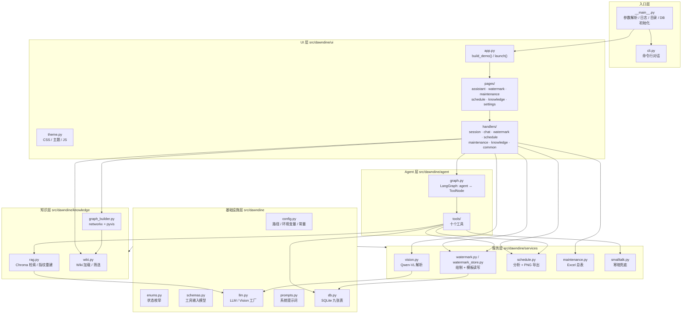
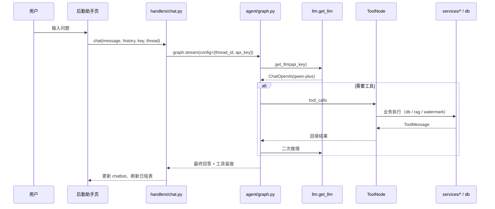

# DawnDine · 架构说明

> 版本：v2.5（四阶段重构后）
> 适用于项目评审、答辩与二次开发。文档描述 `src/` 布局下的分层、依赖方向与关键数据流。

---

## 1. 设计目标

1. **分层清晰**：配置 → 数据 → 知识 → 服务 → Agent → UI，依赖只允许单向向下；
2. **UI 与业务解耦**：页面只声明组件与事件，业务逻辑全部沉到 `services/` 与 `agent/tools/`；
3. **可测试**：不依赖 Gradio 即可对 db、工具、服务、知识库做单元测试；
4. **可打包**：`hatchling` 构建，`dawndine = "dawndine.__main__:main"` 一个命令启动；
5. **零外部基建**：本地文件 + SQLite + Chroma 持久化目录，不需要数据库服务。

---

## 2. 分层结构



依赖规则：

| 层 | 允许依赖 | 禁止依赖 |
|---|---|---|
| `config / enums / schemas / prompts` | 标准库、Pydantic | 任何业务模块 |
| `llm / db` | 上一层 + 第三方 SDK | 服务层、UI |
| `knowledge` | 基础设施层 | 服务层、Agent、UI |
| `services` | 基础设施 + 知识层 | Agent、UI |
| `agent` | 基础设施 + 知识 + 服务 | UI、`__main__` |
| `ui` | 全部下层 | — |
| `__main__` | 全部 | — |

实践中 `ui/handlers` 可以调用 `agent.graph.stream`，但页面本身不直接触碰 `db` 之外的底层细节。

---

## 3. 目录与文件职责

```text
src/dawndine/
├── __main__.py          CLI 参数（--web/--cli/--host/--port/--share/--no-browser）
├── cli.py               终端多轮对话
├── config.py            应用元信息、全部路径、RAG/LLM/日志参数、ensure_runtime_dirs()
├── enums.py             业务状态枚举（日程来源、维修状态、异常等级等）
├── schemas.py           十个工具的 Pydantic 输入模型 + 输出 TypedDict
├── llm.py               get_llm(api_key) / get_vision_llm(api_key) / get_env_api_key()
├── prompts.py           SYSTEM_PROMPT、三步分诊、四类回答、五段式
├── db.py                SQLite：日程、维修、资产、库存、巡检、供应商、人员、反馈、工具留痕
├── knowledge/
│   ├── rag.py           知识切分、写 Chroma、按 manifest 指纹自动重建
│   ├── wiki.py          wiki.json 解析、概览、关键词/分类筛选
│   └── graph_builder.py 分类—实体—关联图，输出 data/kg.html
├── services/
│   ├── vision.py        图片日程 / 维修单结构化解析，统一 JSON 校验
│   ├── schedule.py      只读分析（今日/本周/冲突/待补）+ PNG 表格导出
│   ├── maintenance.py   维修明细与各地统计合并为一个 Excel
│   ├── watermark.py     Pillow 采样主色、四角锚点、内容栏绘制
│   ├── watermark_store.py 模板 JSON 读写与样式备份/还原
│   └── smalltalk.py     无 Key 时的寒暄与能力介绍
├── agent/
│   ├── graph.py         状态图、系统提示注入、动态 Key、thread_id
│   └── tools/           watermark / compliance / knowledge / ledger / checklist /
│                        abnormal / inspection / schedule / logistics
└── ui/
    ├── theme.py         CSS 变量、深色主题、document 级事件委托脚本
    ├── app.py           build_demo() 组装与 launch()
    ├── pages/           六个页面模块，各自返回组件字典
    └── handlers/        页面事件的纯函数回调
```

---

## 4. 启动链路

```text
uv run dawndine
  → configure_logging()           # 只在此处 basicConfig，压低 httpx/chromadb 噪声
  → ensure_runtime_dirs()         # data / knowledge / templates / chroma / uploads / watermarked / exports
  → init_db()                     # 建表、迁移列、写入默认数据
  → build_parser()                # 解析参数
  → 警告：未配置 DASHSCOPE_API_KEY（不阻塞启动）
  → --cli ? cli.run_cli()
           : ui.app.launch(host, port, share, inbrowser)
```

`launch()` 内部：

```text
build_demo()
  → theme.py 注入 CSS/JS
  → pages/*.build_*() 生成组件
  → handlers/*.bind_*() 绑定事件
  → Blocks.load → init_session()
        → uuid4 thread_id
        → 清空 Key 状态
        → 刷新日程 / 维修 / 模板 / 数据库概览 / Wiki
```

---

## 5. Agent 数据流



要点：

- `configurable.thread_id` 由浏览器会话生成，`MemorySaver` 按 thread 隔离记忆；
- `api_key` 随 config 传入，`get_llm` 每次按请求新建客户端，不缓存 Key；
- `ToolNode(handle_tool_errors=True)` 保证工具异常不打断整轮对话；
- `GRAPH_RECURSION_LIMIT=12` 防止工具循环；
- 工具执行后通过 UI 的 `.then()` 刷新日程/维修表，页面与业务不直接耦合。

---

## 6. 关键业务流

### 6.1 水印

```text
样图上传 → services/watermark_store 建模板 JSON
        → services/watermark 采样主色/字号/锚点
        → 内容栏合并（地点/时间可选、置顶或置底）
        → watermarked/{uuid}.png
        → db.create_schedule(source=水印)
```

四角锚点（最左上/最右下）贴边绘制，同组元素紧贴堆叠；样式切换可逆，
倍率基于 `base_font_sizes` 累乘而不累积。

### 6.2 图片日程 / 维修单

```text
图片 → services/vision.parse_*（Qwen-VL，固定 JSON schema）
     → 字段校验与补齐（待补 / 日期归一）
     → db.bulk_create_schedules / create_maintenance
     → 刷新表格与统计
```

### 6.3 知识库

```text
data/knowledge/*.txt + wiki.json
  → knowledge/rag.py：切分（500/80）→ text-embedding-v1 → Chroma(dawndine_knowledge)
  → manifest 指纹（文件列表 + mtime + size）变化时自动重建
  → knowledge/wiki.py 提供检索与分类筛选
  → knowledge/graph_builder.py 生成 data/kg.html（iframe srcdoc 内联）
```

### 6.4 台账与导出

```text
工具写库 → db 九表
  → 维修：db.list_maintenance_rows() + count_by_location()
  → services/maintenance.py → exports/maintenance-report-*.xlsx（两个工作表）
  → 日程：services/schedule.py → exports/schedule-*.png / 分析 Markdown
```

---

## 7. 数据存储

| 存储 | 位置 | 是否入库 | 说明 |
|---|---|---|---|
| SQLite | `data/dawndine.db` | 否 | 九张业务表，首次启动自动建表 |
| Chroma | `data/chroma/` | 否 | 知识向量索引，可由 txt + wiki 重建 |
| 水印模板 | `data/templates/*.json` | 是 | 用户模板，默认模板随仓库提供 |
| 知识资产 | `data/knowledge/` | 是 | 30 份制度 txt + `wiki.json` |
| 图谱 | `data/kg.html` | 否 | 每次刷新重写 |
| 上传/成品/导出 | `uploads/ watermarked/ exports/` | 否 | 仅保留 `.gitkeep` |
| 密钥 | `.env` | 否 | 仅 `.env.example` 入库 |

---

## 8. 测试与质量

```powershell
uv run pytest          # 22 个测试文件，覆盖 db/工具/服务/知识库/选择交互/水印布局
uv run ruff check .    # E,F,I,UP,B；line-length 100
```

测试策略：

- `db` 使用临时路径，不污染 `data/dawndine.db`；
- 工具以「纯函数 + 显式参数」测试，不启动 Gradio；
- 水印以像素/坐标断言，避免依赖字体渲染差异过大；
- UI 交互（整行勾选、拖动框选）通过函数级单测覆盖核心算法。

---

## 9. 扩展指引

| 需求 | 改动位置 |
|---|---|
| 新增工具 | `schemas.py` 加输入模型 → `agent/tools/` 新文件 → `tools/__init__.py` 注册 |
| 新增页面 | `ui/pages/` 新模块 → `ui/app.py` 组装 → 导航 Radio 增加选项 |
| 换模型 | `config.py` 中 `QWEN_*` 或 `.env` 覆盖 |
| 新增业务表 | `db.py` 建表 + `enums.py` 状态 + 对应服务与页面 |
| 换 UI 框架 | 只需重写 `ui/`，`agent`/`services`/`knowledge` 不受影响 |

---

## 10. 已知边界

- 不做 OCR 之外的图像理解，不保证极端模糊照片的解析正确率；
- 知识库为本地规则文本，不覆盖地方性法规更新；
- 多人公网部署时 Chroma 与 SQLite 为单机文件，不做并发写入优化；
- 输出为草稿与建议，不替代现场判断与责任认定。
